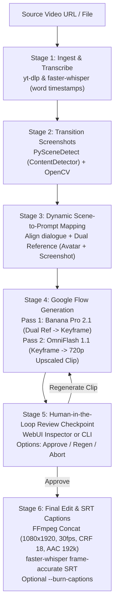

# 🎬 Flow Reel Recreation Pipeline & Studio (GTA1 MCP Flow)

A production-ready, automated video recreation pipeline and modern **Visual Studio WebUI** that takes any reference video, recreates every scene using your AI avatar in **Google Flow** (Banana Pro 2.1 for images → OmniFlash 1.1 for video), halts at a mandatory human review checkpoint, and stitches the final video with frame-accurate SRT captions.

---

## 🌐 Visual Studio WebUI (`http://127.0.0.1:8000`)

You can manage all jobs, inspect generated scenes, and create new ones through the built-in dark-mode WebUI:

```bash
python studio.py
# or double-click start_studio.bat
```

### Studio WebUI Capabilities:
1. **Projects Gallery**: Browse old and new projects with thumbnails, creation timestamps, durations, and live status badges.
2. **Side-by-Side Scene Inspector**:
   - Original Scene Screenshot vs. Banana Pro 2.1 Keyframe vs. OmniFlash 1.1 Video Clip.
   - Built-in video player for every generated clip.
   - Spoken dialogue & dynamic prompt disclosures.
3. **One-Click Stage 5 Review & Regeneration**:
   - Regenerate individual clips or keyframe images with custom prompt adjustments.
   - "Approve All & Stitch Final Reel" button to execute Stage 6.
4. **Final Reel & SRT Player**:
   - Master video player (1080x1920 30fps).
   - Captioned reel player with burned-in subtitles.
   - Download links for videos and `.srt` file.
5. **New Project Launcher**:
   - Input video URL or local file path.
   - Avatar gallery with one-click image uploader and preview.
   - Execution modes: *Dry Run (0 cr)*, *Review Checkpoint*, or *Full Automatic*.
   - Live Google Flow credit balance and status monitor.

---

## 🏗️ Architecture Overview



---

## 📋 Connected GTA1 MCP Flow Integration

1. **Dual Reference Ingredients in Banana Pro 2.1:**
   - **Reference 1:** `avatar.jpg` (locks the avatar's face, hair, and facial structure).
   - **Reference 2:** `scene_XX.jpg` (locks the exact scene framing, food, props, and setting).
2. **OmniFlash 1.1 First Frame Video Pass:**
   - Feeds the generated keyframe as `first_frame` into Omni 1.1 Flash (4s/6s/8s/10s).
   - Prompts include specific culinary action, props movement, and dialogue timeline.
3. **Pacing & Resumption:**
   - Saves state to `state.json` after every single clip.
   - Automatically maintains a 15-second cooldown between scenes to protect against rate limits.

---

## 🚀 CLI Usage

### 1. Launch Studio WebUI:
```bash
python studio.py
```
Open [http://127.0.0.1:8000](http://127.0.0.1:8000) in your browser.

### 2. Dry Run (Stages 1–3) — 0 Credits:
```bash
python run_reel.py "<VIDEO_URL_OR_PATH>" --dry-run
```

### 3. Full Recreation (Stops at Review Checkpoint):
```bash
python run_reel.py "<VIDEO_URL_OR_PATH>" --avatar "./avatar.jpg" --stop-at-review
```

### 4. Full Recreation with Burned-In Viral Pop Captions:
```bash
python run_reel.py "<VIDEO_URL_OR_PATH>" --avatar "./avatar.jpg" --burn-captions --caption-style yellow-pop
```

---

## ⚡ Dedicated Caption & Editing Tool (`caption_editor.py`)

A standalone tool that takes Flow-generated clips from a completed job (or any video), stitches them into a 9:16 vertical reel, transcribes with word-level timestamps using `faster-whisper`, and burns viral short-form captions where the text appears crisp white with a thick black outline and every spoken word pops in vibrant yellow (`#FFE135`) with scale bounce:

### Automatic Stitch & Caption from a Flow Job:
```bash
python caption_editor.py --job-id <JOB_ID> --style yellow-pop --words-per-screen 3
```

### Caption Any Existing Video:
```bash
python caption_editor.py --video path/to/video.mp4 --style yellow-pop --output captioned.mp4
```

### Available Styles:
- `--style yellow-pop`: Vibrant yellow pop (`#FFE135`), standard for viral TikTok / YouTube Shorts / Reels.
- `--style green-pop`: Neon green pop (`#22C55E`).
- `--style cyan-pop`: Electric cyan pop (`#06B6D4`).
- `--style clean-white`: Minimalist clean bold white (`#FFFFFF`).

### Available Positions:
- `--position lower-third`: Safe zone above TikTok/Reels interface overlays (default).
- `--position middle`: Dead center of the frame.
- `--position bottom`: Bottom edge.
